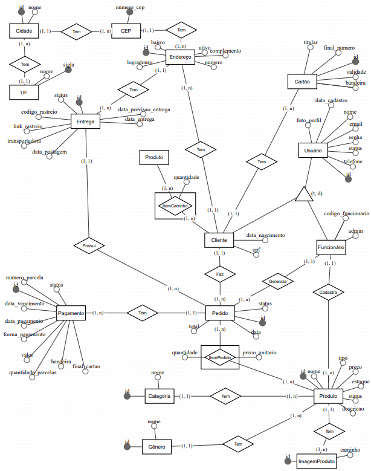
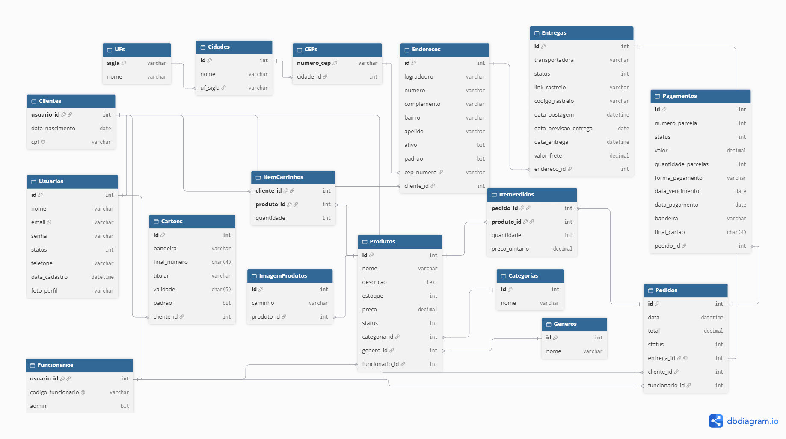
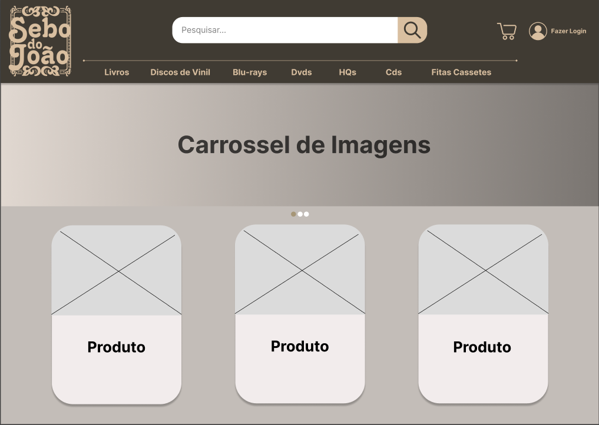
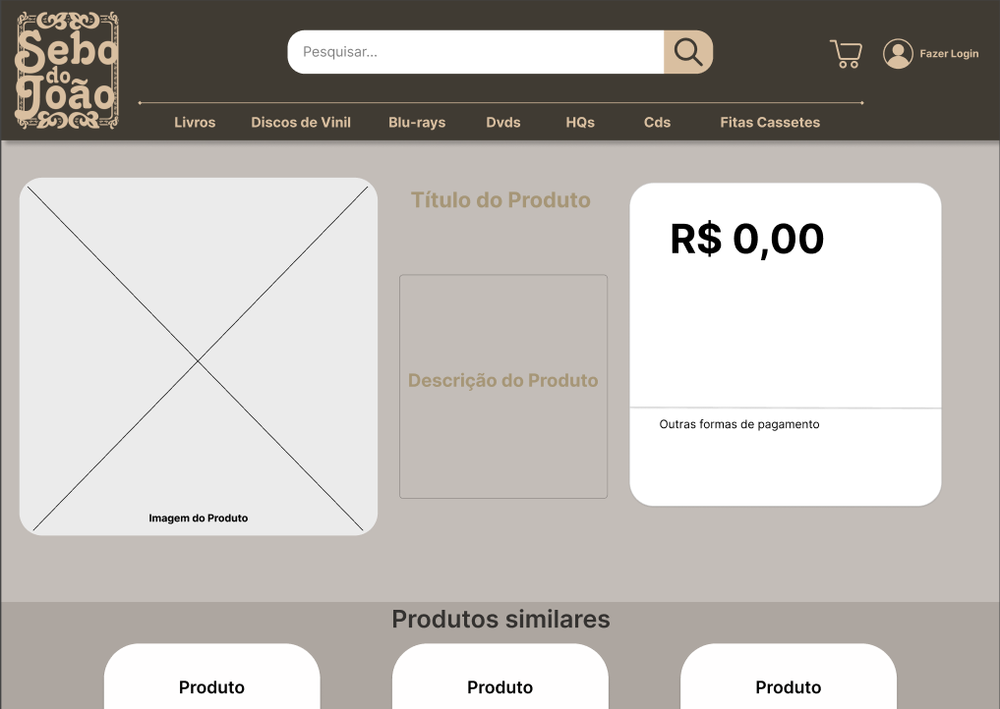
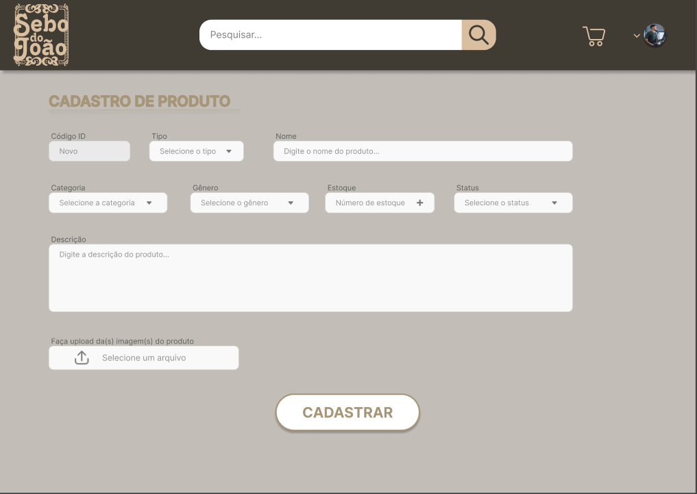
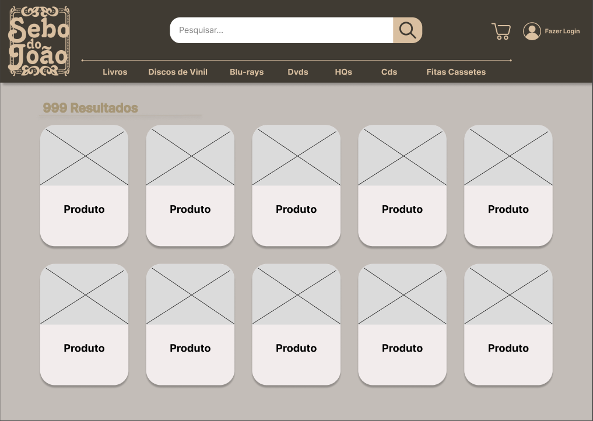
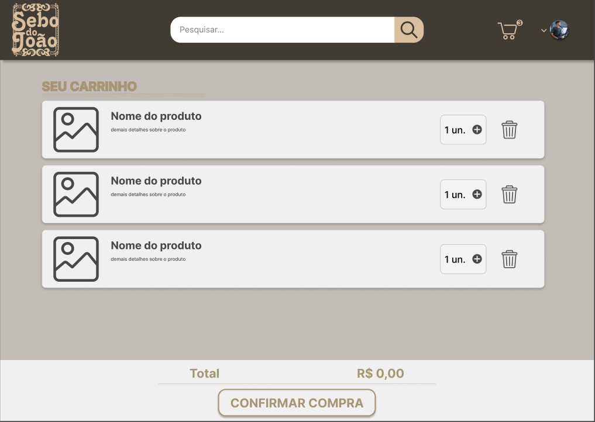
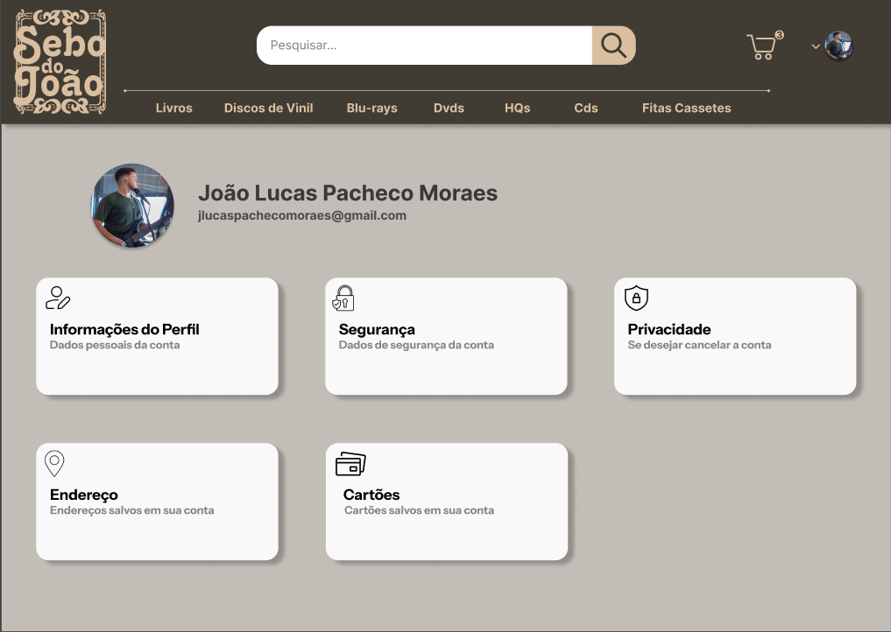

# 📚 Sebo do João — Sistema de E-commerce (Loja Virtual)

> **Projeto Interdisciplinar** desenvolvido para a digitalização dos processos do Sebo do João, uma tradicional loja física de São José do Rio Preto (SP), por meio da implementação de uma plataforma de e-commerce para comercialização e gerenciamento de produtos.
---

## 🏪 Sobre o Sebo do João

O **Sebo do João** é uma loja tradicional da cidade de São José do Rio Preto (SP), especializada na compra e venda de itens culturais.

📍 **Endereço:** Rua Conselheiro Saraiva, 163 — Vila Ercília, São José do Rio Preto — SP, 15013-090

A loja possui um amplo acervo de produtos culturais, com destaque para:

- 📀 Discos de vinil (principal destaque do acervo)
- 📚 Livros
- 💿 CDs
- 📀 DVDs e Blu-rays
- 🖼️ HQs e Mangás
- 📻 Fitas cassete (VHS)  

---

## 🎯 Objetivo do Projeto

O sistema tem como objetivo modelar e estruturar um ambiente de e-commerce voltado às necessidades de compra e venda da loja, promovendo sua inserção no meio digital. Além disso, busca organizar e otimizar os processos internos, facilitando a gestão de produtos e a realização das operações.

---

## 🧱 Estado Atual do Desenvolvimento

O projeto encontra-se na fase inicial de desenvolvimento, com foco em modelagem e estruturação do sistema.

Até o momento foram desenvolvidos:

- 📑 Levantamento de Requisitos e construção do Diagrama de Classes para identificação das funcionalidades do sistema, modelagem das entidades e definição de seus relacionamentos.
- 📦 Entidades do sistema em **Java (pacote `model`)**.
- 🧪 Instanciação e testes das classes na classe `Main`.
- 🗄️ Modelagem conceitual do banco de dados através do **DER**.
- 🧾 Criação das tabelas e inserção de dados (aproximadamente 10 inserts por tabela) em **SQL Server**.
- 🎨 Protótipos das principais interfaces do sistema desenvolvidos no **Figma**.

---

## 🧾 Diagramas do Sistema
Diagramas de modelagem do sistema:


##### DER (Diagrama de Entidade e Relacionamento)


##### Diagrama de Banco de Dados


---

## 🖥️ Interfaces do Sistema

A seguir estão os protótipos das principais interfaces desenvolvidas para o sistema:


##### Tela de Index


##### Tela de Cadastro de Cliente


##### Tela de Login de Cliente


##### Tela de Informações do Produto


##### Tela de Cadastro de Produto


##### Tela de Resultados de Pesquisa


##### Tela de Carrinho de Compras


##### Tela de Informações do Cliente


##### Tela de Edição de Informações do Cliente

---

📁 Todos os documentos estão organizados na pasta `/docs` do repositório.

---

## 🛠️ Tecnologias Utilizadas

- 📋 Umbrello — Diagrama de Classes  
- ☕ Java — modelagem das entidades do sistema  
- 🛢️ DbDiagram.io — Modelagem de Banco de Dados  
- 📊 BrModelo — modelagem do DER  
- 🗄️ SQL Server — banco de dados relacional  
- 🎨 Figma — prototipação das interfaces  

---

## 📁 Estrutura do Repositório

```text
sebo-do-joao/
├── docs/
│   ├── diagramas/
│   │   ├── DER-Sebo_do_Joao.png
│   │   ├── Diagrama_Banco_de_Dados.png
│   │   └── ...
│   ├── interfaces/
│   │   ├── Tela-principal-index.png
│   │   ├── Tela-cadastro-cliente.png
│   │   └── ...
│   ├── metodos-estatisticos/
│   │   └── planilha-analise-estatistica-interdisciplinar.xlsx
│   ├── sql/
│   │   ├── SeboDoJoao.sql
│   │   ├── SeboDoJoao_INSERTS.sql    
│   │   ├── SeboDoJoao_SELECTS.sql
│   │   ├── SeboDoJoao_VIEWS.sql
│   │   ├── SeboDoJoao_FUNCTIONS.sql
│   │   ├── backup-sql/
│   │   │   └── Sebo_Do_Joao.bak
│   │   └── ...
│   └── testes/   
│       ├── dados-testes.txt
│       └── Selects-de-testes.sql
|
├── java/
│   ├── seboDoJoao/
│   │   └── src/
│   │       ├── main/
│   │       │   ├── java/br/com/interdisciplinar/sebodojoao/
│   │       │   │   ├── dto/
│   │       │   │   ├── model/
│   │       │   │   ├── repository/
│   │       │   │   ├── restcontroller/
│   │       │   │   ├── service/
│   │       │   │   └── SebodojoaoApplication.java
│   │       │   └── resources/
│   │       │       ├── static/  
│   │       │       │   ├── css/
│   │       │       │   ├── data/
│   │       │       │   ├── imagens/
│   │       │       │   ├── js/
│   │       │       │   ├── index.html
│   │       │       │   └── ...
│   │       │       └── application.yaml   
│   │       └── test/
│   │           └── ...
│   ├── target/
│   ├── mvnw
│   ├── pom.xml
│   └── ...
│
└── README.md
